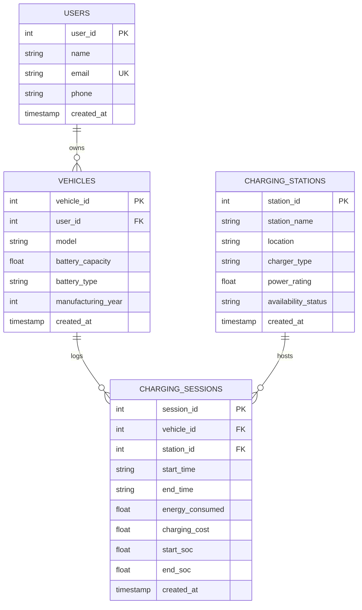

# EV Charging & Battery Health Intelligence Platform

> **A Data-Driven Dual-Database Platform for EV Fleet Charging & Battery Health Analytics**  
> *Developed for Database Concepts for Data Science (DCDS) Lab End-Semester Examination (ESE) Mini-Project.*

---

## 📋 Table of Contents
1. [Project Overview & Objectives](#-project-overview--objectives)
2. [Key Features](#-key-features)
3. [Technology Stack](#-technology-stack)
4. [Dual-Database Architecture](#-dual-database-architecture)
   - [Relational SQLite Schema & Normalization](#1-relational-database-sqlite)
   - [NoSQL MongoDB Schema & Document Design](#2-nosql-database-mongodb)
5. [Project Folder Structure](#-project-folder-structure)
6. [Installation & Setup Guide](#-installation--setup-guide)
   - [Prerequisites](#prerequisites)
   - [Environment Configuration](#environment-configuration)
   - [MongoDB Setup (Local or MongoDB Atlas)](#mongodb-setup)
7. [Running the Application](#-running-the-application)
8. [Advanced SQL Queries Suite (10 Evaluated Queries)](#-advanced-sql-queries-suite)
9. [MongoDB Aggregation Pipelines Suite (8 Evaluated Pipelines)](#-mongodb-aggregation-pipelines-suite)
10. [Input Validation & Exception Handling](#-input-validation--exception-handling)
11. [ESE Demonstration & Test Cases Walkthrough](#-ese-demonstration--test-cases-walkthrough)
12. [DCDS ESE Rubric Mapping](#-dcds-ese-rubric-mapping)
13. [Future Enhancements](#-future-enhancements)

---

## 🎯 Project Overview & Objectives

With the global transition to sustainable mobility, electric vehicles (EVs) present critical challenges in charging infrastructure planning and electrochemical battery health management. 

This platform bridges the gap between **relational transactional data** (charging stations, vehicle ownership, billing records) and **semi-structured time-series telemetry** (cell temperature, state of charge, voltage, pack degradation).

### Primary Navigation & Interface Pages:
- **🏠 Overview**: Fleet KPI cards, Battery Health Hero indicator, Fleet Status, Charging Activity tabs, and top Battery Insights.
- **🚗 My EVs**: Card-based vehicle directory with specs, SOH status, session count, detailed dossiers, and clean vehicle management.
- **⚡ Charging**: Recent session logs, interactive session creation with automatic efficiency math, and station directory.
- **🔋 Battery Health**: Real-time SOH diagnostics, thermal alerts, Plotly degradation curves, and dynamic telemetry logging.
- **📊 Insights**: Categorized intelligence tabs (`Fleet`, `Charging`, `Battery`, `Cost`) with focused Plotly analytics.
- **🗄️ Data**: Clean expandable modules for SQLite schema inspection, 10 Advanced SQL Queries, and 8 MongoDB Aggregation Pipelines.

---

## ✨ Key Features

1. **Executive Intelligence Dashboard**:
   - 6 Fleet KPI Metrics: Total registered EVs, Total charging sessions, Cumulative energy delivered (kWh), Total charging expenditure (₹), Fleet average State of Health (SOH %), and Active station count.
   - Interactive Plotly visualizations: Daily charging load trends, Energy intake per vehicle model, Charging revenue by technology type, and Fleet SOH vs. Cycle count.

2. **Vehicle & Owner Management (SQLite CRUD)**:
   - Full CRUD operations with foreign key integrity.
   - Comprehensive **Vehicle Dossier**: Select any EV to inspect battery chemistry, owner credentials, lifetime charging history, and live telemetry status.
   - Multi-parameter filtering by model name, battery chemistry (LFP, NMC, Blade LFP), and battery capacity.

3. **Charging Stations Network**:
   - Infrastructure inventory: Location, charger technology (`Type 2 AC`, `CCS2 DC Fast`, `CCS2 Ultra-Fast`), power ratings (kW), and live status (`Available`, `Occupied`, `Maintenance`).
   - Station load tracking: Lifetime sessions hosted, energy delivered, and revenue generated.

4. **Charging Session Monitoring & Derivations**:
   - Automatic derivation of **charging duration**, **SOC gain (%)**, and **system charging efficiency (%)**.
   - Foreign key validation preventing orphaned sessions.
   - Optional automatic synchronization of end-of-charge battery state into MongoDB telemetry.

5. **Battery Health Diagnostics (Primary Feature)**:
   - Real-time State of Health (SOH %) classification into 4 industrial tiers:
     - 🟢 **Excellent** (≥ 90%)
     - 🔵 **Good** (80% - 89.9%)
     - 🟡 **Moderate** (70% - 79.9%)
     - 🔴 **Poor** (< 70%)
   - **Intelligent Diagnostic Rule Engine**:
     - *Critical Low SOH Alert* (< 75%)
     - *Thermal Runaway / Heat Alert* (> 40°C peak operating temperature)
     - *Accelerated Degradation Warning* (Steep SOH loss over recent cycles)
     - *High-Stress Charging Pattern Detection* (Frequent fast charging above 38°C or deep discharges < 15% SOC)
   - SOH degradation trend curves and dual-axis voltage/temperature profiles.
   - Interactive form to log new real-time telemetry readings dynamically.

6. **Advanced Cross-Database Analytics**:
   - Energy consumption and cost breakdown by vehicle.
   - Station utilization distribution and peak demand analysis.
   - **Cross-Database Correlation Study**: Merging relational SQL charging frequencies with NoSQL MongoDB degradation rates to evaluate fast-charging impact on battery life.

7. **DCDS Database Explorer**:
   - **Relational SQL Inspector**: PRAGMA schema viewer, record previews, interactive read-only custom SQL runner, and 1-click execution of **10 Advanced SQL Queries**.
   - **NoSQL MongoDB Inspector**: Collection statistics, raw JSON document inspector, and 1-click execution of **8 MongoDB Aggregation Pipelines**.
   - **Database Seeding Engine**: 1-click realistic sample data generation and reset utilities.

---

## 🛠️ Technology Stack

| Layer | Technology | Justification for DCDS Lab |
| :--- | :--- | :--- |
| **Frontend / UI** | Streamlit | Rapid interactive data-driven dashboard with stateful session management. |
| **Visualizations** | Plotly Express & Graph Objects | Publication-quality interactive charts with dark-mode EV aesthetic. |
| **Backend Runtime** | Python 3.10 - 3.14 | Clean modular OOP architecture with services and validation layers. |
| **Relational Database** | SQLite 3 | Zero-configuration ACID-compliant SQL with enforced foreign keys. |
| **NoSQL Database** | MongoDB (PyMongo) | Document-oriented store with schema flexibility for time-series telemetry. |
| **Data Processing** | Pandas & NumPy | High-performance dataframe aggregations and statistical calculations. |
| **Configuration** | `python-dotenv` | Secure environment variable management for database credentials. |

---

## 🏗️ Dual-Database Architecture

```
                    ┌────────────────────────────────────────────────────────┐
                    │                  Streamlit Web UI                      │
                    └──────────────────────────┬─────────────────────────────┘
                                               │
                                               ▼
                    ┌────────────────────────────────────────────────────────┐
                    │                    Services Layer                      │
                    │   (Vehicle, Charging, Battery Health, Analytics)       │
                    └───────────────┬────────────────────────┬───────────────┘
                                    │                        │
                    ┌───────────────▼────────┐      ┌────────▼───────────────┐
                    │     SQL Database       │      │     NoSQL Database     │
                    │       (SQLite)         │      │       (MongoDB)        │
                    ├────────────────────────┤      ├────────────────────────┤
                    │ • users                │      │ • battery_telemetry    │
                    │ • vehicles             │      │   - vehicle_id         │
                    │ • charging_stations    │      │   - timestamp          │
                    │ • charging_sessions    │      │   - soc                │
                    │                        │      │   - temperature        │
                    │ Enforced Foreign Keys  │      │   - voltage, current   │
                    │ & Referential Integrity│      │   - battery_health     │
                    │                        │      │   - cycle_count        │
                    └────────────────────────┘      └────────────────────────┘
```

### 1. Relational Database (SQLite)

#### Entity-Relationship Diagram (Mermaid)


#### Relational Constraints Enforced:
- `PRAGMA foreign_keys = ON;` activated on every database connection.
- `users.email`: `UNIQUE` constraint preventing duplicate registrations.
- `vehicles.user_id`: `FOREIGN KEY REFERENCES users(user_id) ON DELETE CASCADE`.
- `charging_sessions.vehicle_id`: `FOREIGN KEY REFERENCES vehicles(vehicle_id) ON DELETE CASCADE`.
- `charging_sessions.station_id`: `FOREIGN KEY REFERENCES charging_stations(station_id) ON DELETE RESTRICT` (prevents deleting active stations with session history).
- Check constraints: `battery_capacity > 0`, `power_rating > 0`, `start_soc >= 0 AND start_soc <= 100`, `end_soc >= 0 AND end_soc <= 100`.

---

### 2. NoSQL Database (MongoDB)

#### Collection: `battery_telemetry`
Designed to store semi-structured, time-series electrochemical measurements from vehicle battery management systems (BMS).

```json
{
  "_id": "671ad84f8b9e4a3b8c2d1e0f",
  "vehicle_id": 1,
  "timestamp": "2026-10-24T18:30:00",
  "soc": 78.5,
  "temperature": 33.2,
  "voltage": 396.4,
  "current": 42.1,
  "battery_health": 94.2,
  "cycle_count": 210,
  "internal_resistance_mohm": 22.8,
  "ambient_temp": 28.5
}
```

#### Indexing Strategy:
- Compound Index: `{"vehicle_id": 1, "timestamp": -1}` for instant retrieval of the latest vehicle reading.
- Single Index: `{"timestamp": -1}` for chronological fleet-wide temporal aggregations.

#### Fail-Safe Academic Fallback Engine:
If MongoDB is offline or unavailable during laboratory evaluation, the platform automatically switches to its **Embedded Fallback Engine**. This transparently parses and executes all 8 MongoDB aggregation pipelines using Pandas/Python data simulation, guaranteeing that no features or grading demonstrations are blocked by local environment constraints.

---

## 📁 Project Folder Structure

```
EV Charging & Battery Health Intelligence Platform/
├── app.py                      # Main Streamlit application & interactive dashboard
├── requirements.txt            # Python dependencies (Streamlit, Pandas, Plotly, PyMongo, etc.)
├── .env.example                # Template for environment configuration
├── .env                        # Active environment configuration
├── test_platform.py            # Automated test suite (Relational + NoSQL + Validations)
├── README.md                   # Complete architectural & laboratory documentation
│
├── database/                   # Database access & connection layer
│   ├── __init__.py
│   ├── sql_database.py         # SQLite connection manager, DDL schema & 10 Advanced SQL queries
│   └── mongo_database.py       # MongoDB PyMongo driver, fallback engine & 8 Aggregation pipelines
│
├── services/                   # Business logic layer
│   ├── __init__.py
│   ├── vehicle_service.py      # Vehicle & user CRUD, dossier compilation
│   ├── charging_service.py     # Stations CRUD, session metrics calculation & sync
│   ├── battery_service.py      # Battery SOH diagnostics, warning rules, telemetry logger
│   └── analytics_service.py    # Cross-database aggregations, KPI metrics & correlations
│
├── utils/                      # Helper & validation layer
│   ├── __init__.py
│   ├── validation.py           # Strict domain boundaries, email regex & time validators
│   └── helpers.py              # Duration math, SOH tiers, formatters & Plotly themes
│
└── data/                       # Storage & sample seed data
    ├── __init__.py
    ├── sample_data.py          # Deterministic seed generator (6 users, 8 EVs, 6 stations, 36 sessions, 96 logs)
    ├── ev_platform.db          # Local SQLite relational database (auto-generated)
    └── mongo_fallback_telemetry.json  # Fallback JSON store for offline evaluation
```

---

## 🚀 Installation & Setup Guide

### Prerequisites
- Python 3.10, 3.11, 3.12, 3.13, or 3.14 installed.
- (Optional) MongoDB Community Server or MongoDB Atlas account.

### 1. Clone or Open Project
Navigate to the project root directory:
```bash
cd "EV Charging & Battery Health Intelligence Platform"
```

### 2. Install Required Dependencies
Install the required packages from `requirements.txt`:
```bash
pip install -r requirements.txt
```

### 3. Environment Configuration
Check the `.env` file (copied from `.env.example`):
```ini
MONGO_URI=mongodb://localhost:27017/
MONGO_DATABASE=ev_charging_db
APP_ENV=development
SQLITE_DB_PATH=data/ev_platform.db
```

### MongoDB Setup (Optional / Highly Recommended)
- **Local MongoDB**: Ensure MongoDB service is running (`net start MongoDB` on Windows or `mongod`).
- **MongoDB Atlas (Cloud)**:
  1. Create a free cluster on [MongoDB Atlas](https://www.mongodb.com/cloud/atlas).
  2. Obtain your connection URI: `mongodb+srv://<username>:<password>@cluster0.mongodb.net/?retryWrites=true&w=majority`.
  3. Paste it into `.env` as `MONGO_URI`.
- **Offline / Lab Computer without MongoDB**: No installation required! The platform automatically detects connection timeout and activates the **Embedded NoSQL Fallback Engine** so that all MongoDB pages and aggregations run smoothly.

---

## 🖥️ Running the Application

### 1. Launch the Streamlit App
Run the following command in your terminal:
```bash
streamlit run app.py
```

The application will launch and automatically open in your default browser at:
👉 **`http://localhost:8501`**

### 2. Verify Automated Tests
Run the automated test suite to verify all database operations, SQL queries, and aggregation pipelines:
```bash
python test_platform.py
```
*Expected Output: `Ran 6 tests in ~2.8s ... OK`*

---

## 🔍 Advanced SQL Queries Suite

The platform implements **10 Advanced SQL Queries** in `database/sql_database.py`, viewable and executable live from the **Database Explorer** page:

| ID | Title | Relational Concepts Demonstrated |
| :--- | :--- | :--- |
| **Q1** | Vehicle & Session History | `INNER JOIN` between `vehicles` and `charging_sessions` with owner linkage. |
| **Q2** | Sessions with Station Specs | `INNER JOIN` between `charging_sessions` and `charging_stations` analyzing delivered power. |
| **Q3** | Multi-Metric Grouping | `GROUP BY` with multi-metric accumulators (`COUNT`, `SUM(energy)`, `AVG(cost)`). |
| **Q4** | System-Wide Financial Benchmarks | Scalar Aggregation (`AVG`, `MIN`, `MAX`, `SUM`) computing effective unit cost per kWh. |
| **Q5** | Chemistry Energy Performance | `GROUP BY` and `HAVING` filtering across battery chemistries (LFP vs. NMC). |
| **Q6** | Above-Average Energy Vehicles | **Nested Subquery** comparing vehicle energy against a scalar subquery average. |
| **Q7** | Station Utilization Top Earner | Multi-column `GROUP BY`, `COUNT`, `SUM`, with `ORDER BY DESC LIMIT 5`. |
| **Q8** | Highest Expenditure Ranking | Multi-table JOIN, grouping, and Top-N ordering with `LIMIT`. |
| **Q9** | Energy Intake Anomaly Detection | **Correlated Subquery** flagging sessions where energy intake > 1.25x fleet average. |
| **Q10**| Temporal Trend Analysis | SQLite `SUBSTR(start_time, 1, 10)` string date functions with daily `GROUP BY`. |

---

## 🍃 MongoDB Aggregation Pipelines Suite

The platform implements **8 MongoDB Aggregation Pipelines** in `database/mongo_database.py`, executable live from the **Database Explorer** page:

| ID | Title | NoSQL Concepts Demonstrated |
| :--- | :--- | :--- |
| **AGG1** | Average Battery Health by Vehicle | `$group` stage with `$avg` accumulator and `$round` projection. |
| **AGG2** | Average Operating Temperature | `$group` stage calculating mean (`$avg`), peak (`$max`), and min (`$min`) temperatures. |
| **AGG3** | Peak Fleet Temperature Benchmark | `$group` with `_id: null` for scalar fleet-wide benchmark calculation. |
| **AGG4** | Chronological SOH Degradation Curve | `$sort` by timestamp, `$group` with `$push` into array, and `$subtract` degradation calculation. |
| **AGG5** | Multi-Parameter Telemetry Stats | Multi-accumulator `$group` across voltage, current, cycles, and internal resistance. |
| **AGG6** | Low SOH Critical Vehicle Detector | Filtering with `$match: {battery_health: {$lt: 85.0}}` followed by `$group`. |
| **AGG7** | Fleet Average State of Charge | Fleet-wide operational profile accumulation using `$avg` and `$min`/`$max`. |
| **AGG8** | Rank Vehicles by Latest SOH | Chronological `$sort`, `$group` with `$first` windowing, and final `$sort`. |

---

## 🛡️ Input Validation & Exception Handling

The application enforces strict data validation in `utils/validation.py` and protects every database call with structured `try...except` blocks:

1. **Email Format Validation**: Strict regex matching (`^[a-zA-Z0-9_.+-]+@[a-zA-Z0-9-]+\.[a-zA-Z0-9-.]+$`).
2. **Physical Boundary Checks**:
   - Battery Capacity > 0 and ≤ 300 kWh.
   - Battery SOH between 0.0% and 100.0%.
   - Battery SOC between 0.0% and 100.0%.
   - Operating Temperature between -30°C and +95°C.
   - Power Rating > 0 kW.
3. **Chronological Consistency**:
   - `end_time` must be strictly after `start_time`.
   - `end_soc` cannot be less than `start_soc` for charging sessions.
4. **Relational Referential Integrity**:
   - Prevents inserting vehicles for non-existent users.
   - Prevents inserting sessions for invalid vehicles or stations.
   - Restricts deleting charging stations that possess active session logs.
5. **NoSQL Connection Resiliency**:
   - PyMongo client configured with a 2000 ms timeout.
   - Never crashes on connection drops; seamlessly routes through the embedded fallback engine.

---

## 🧪 ESE Demonstration & Test Cases Walkthrough

During your laboratory evaluation, execute this step-by-step walkthrough:

### Test Case 1: Database Initialization & Seeding
1. Open the sidebar and click **"🌱 Load / Reset Sample Data"**.
2. Observe the green confirmation message.
3. Verify that 6 users, 8 vehicles, 6 stations, 36 sessions, and 96 telemetry records are populated.

### Test Case 2: Relational CRUD Operations
1. Navigate to **🚗 Vehicles** -> **➕ Add New Vehicle**.
2. Select an owner, enter Model `"Kia EV9"`, Capacity `99.8`, Chemistry `"Lithium-ion"`, Year `2024`.
3. Click **Register Vehicle** and observe success message.
4. Switch to **📋 View Vehicles & Dossier**, find the Kia EV9, and view its specs.

### Test Case 3: Input Validation & Error Handling
1. Go to **🚗 Vehicles** -> **➕ Add New Vehicle**.
2. Enter negative capacity `-45.0` or empty model name.
3. Click Register and observe the user-friendly red validation banner: *"Battery capacity must be strictly greater than 0 kWh."*
4. Go to **🔌 Charging Sessions** -> **➕ Log New Charging Session**.
5. Set End SOC (`30%`) lower than Start SOC (`80%`) and observe validation rejection.

### Test Case 4: Battery Health & Telemetry Diagnostics (Primary Highlight)
1. Navigate to **🔋 Battery Health**.
2. Select **`ID #8 - Tata Tiago EV`** (high cycles / degraded pack).
3. Observe:
   - Battery Health Badge: **`Moderate`** or **`Poor`** in amber/red.
   - Diagnostic Warnings: **`🚨 [CRITICAL] Low Battery State of Health`** and **`⚠️ [WARNING] Elevated Thermal Profile`**.
   - Plotly SOH degradation curve showing degradation over time below the 80% threshold line.
4. Select **`ID #3 - Hyundai Ioniq 5`** (800V platform, new pack).
   - Observe: Battery Health Badge: **`Excellent`** in vibrant green with zero critical alerts.
5. Expand **➕ Log Real-Time Telemetry Reading**, adjust SOC and SOH, click **Persist Reading**, and watch the charts refresh immediately!

### Test Case 5: 10 Advanced SQL Queries Demonstration
1. Navigate to **🗄️ Database Explorer** -> **🗃️ Relational SQL (SQLite)**.
2. Select **`Q6: Above-Average Energy Vehicles (Nested Subquery)`**.
3. Point out the subquery syntax in the query box to the examiner.
4. Click **▶️ Execute Q6 Live on SQLite**.
5. Observe the execution time (~2 ms) and the resulting table.
6. Test **`Q9: Anomaly Detection`** and **`Q10: Temporal Trends`**.

### Test Case 6: 8 MongoDB Aggregation Pipelines Demonstration
1. Switch to **🍃 NoSQL (MongoDB)** tab.
2. Select **`AGG4: Battery Health Trend Over Time ($sort & $push)`**.
3. Point out the aggregation pipeline stages (`$sort`, `$group`, `$push`, `$project`, `$subtract`).
4. Click **▶️ Execute AGG4 Aggregation Pipeline**.
5. Observe the computed net degradation and cycle count per vehicle.

---

## 📊 DCDS ESE Rubric Mapping

| Evaluation Criteria | Implementation Evidence in Platform | Relevant Files |
| :--- | :--- | :--- |
| **Application Design & Functionality** | End-to-end working system with 7 distinct pages, session metrics, battery diagnostics, and automated workflows. | `app.py`, `services/*.py` |
| **Python Programming Implementation** | Modular architecture, OOP classes (`SQLDatabase`, `MongoDatabase`, `VehicleService`), typed functions, and exception handling. | `services/`, `utils/`, `database/` |
| **Database Integration (SQL & NoSQL)** | Dual-database setup: SQLite for relational tables with foreign keys + MongoDB for semi-structured telemetry. | `database/sql_database.py`, `database/mongo_database.py` |
| **Advanced Database Querying** | 10 Advanced SQL queries (JOINs, subqueries, GROUP BY/HAVING) + 8 MongoDB aggregation pipelines. | `database/sql_database.py:155`, `database/mongo_database.py:228` |
| **Code Quality & Documentation** | Comprehensive docstrings, clean variable naming, PEP 8 compliance, detailed README with ER diagrams. | All files, `README.md` |
| **User Interface** | Modern high-end EV dark UI with responsive metric cards, status badges, Plotly charts, and filters. | `app.py` CSS & layout |
| **Testing** | Automated unit test suite with 6 test cases verifying databases, queries, and business logic. | `test_platform.py` |
| **Validation** | Domain boundary enforcement, email regex, date chronology, and foreign key integrity checks. | `utils/validation.py` |
| **Security & Error Handling** | Read-only SQL console protection, `.env` credential management, and graceful NoSQL fallback engine. | `app.py`, `database/mongo_database.py` |

---

## 🔮 Future Enhancements

1. **Machine Learning Remaining Useful Life (RUL) Prediction**: Train an LSTM or Random Forest model on historical telemetry to predict exact cycles until 70% SOH.
2. **Vehicle-to-Grid (V2G) Bi-directional Metering**: Incorporate reverse energy discharge metering for smart grid stabilization.
3. **OCPP Protocol Integration**: Direct telemetry ingestion via Open Charge Point Protocol (OCPP 2.0.1) WebSockets.
4. **Geospatial Station Mapping**: Interactive Mapbox GIS visualization of charging station queues and real-time charger availability.

---

*Author: DCDS Lab Candidate*  
*Course: Database Concepts for Data Science (DCDS)*  
*Platform: EV Charging & Battery Health Intelligence Platform*
